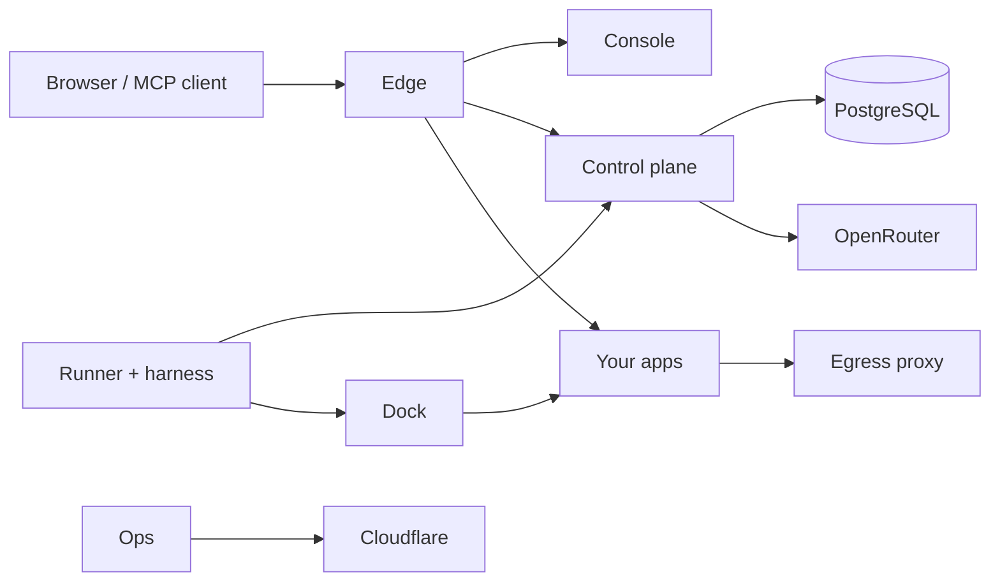

<div align="center">

# FrostAura Endgame

**One place to research, build, host and operate every product you own.**

[](https://github.com/frostaura/technologies.fa.endgame/actions/workflows/ci.yml)
[](https://github.com/frostaura/technologies.fa.endgame/actions/workflows/pages.yml)
[](https://frostaura.github.io/technologies.fa.endgame/)


### [Open the Endgame Academy →](https://frostaura.github.io/technologies.fa.endgame/)

Every flow in the product, step by step, in a live demo that runs in your browser.

</div>

---

## What it is

Endgame is a single organisation tree — organisation, divisions, projects, apps — whose
permissions, secrets, budgets, AI employees and context inherit downward. You type an idea into it.
Endgame researches the idea, gives a verdict, builds the app part by part, and runs it in its own
container at its own address, on services every app shares. One bill, in credits, covers all of it.

## What it does

| | |
| --- | --- |
| **Researches** | An idea is researched with live models and returned with a verdict. A weak verdict stops the build before credits are spent on it. |
| **Builds** | A factory of AI employees plans the app, builds it part by part and reviews each part. Every run is traced, and estimated in credits before it starts. |
| **Hosts** | Each app runs privately in its own container, with its own database and address. It sleeps when idle and wakes on the next request. |
| **Operates** | Sign-in, secrets, e-mail, schedules, telemetry and model access are the same platform services under every app. |
| **Changes** | An app is changed in words. The change is built in a preview, and everything the app did before is checked again. |
| **Answers** | Ask about any app in plain language, or reach the whole organisation from your own AI assistant over MCP. |
| **Accounts** | A credit ledger with reservations, per-app caps and a full record of where every credit went. |

Going public, topping up credits, overdraft and export are always done by a person, never by an agent.

## See it without installing anything

The **[Endgame Academy](https://frostaura.github.io/technologies.fa.endgame/)** is published from
this repository on every push to `main`.

- **Every flow, step by step** — in five tracks, for clients and for operators.
- **A live demo** — the real console, running against an in-browser stand-in for the server, with
  mock data. Nothing you do there is stored or sent anywhere.
- **Search**, a free-play demo, and two PDFs: the
  [client academy](https://frostaura.github.io/technologies.fa.endgame/academy.pdf) and the
  [operator handbook](https://frostaura.github.io/technologies.fa.endgame/operator-handbook.pdf).

The academy is generated from [`docs/flows/`](docs/flows/README.md), so it changes when the
product does.

## How it is put together



| Service | Role |
| --- | --- |
| **Edge** | The single entry point. Routes to the console, the API and each app; wakes sleeping apps. |
| **Control plane** | The tree and its cascade, passkey sign-in, the credit ledger, the model gateway, runs, and the platform API apps use. |
| **Runner** | Works research, build, review and conversation runs with Endgame's own agent harness. |
| **Dock** | Workspaces, builds and the app lifecycle. The only service given the Docker socket. |
| **Console** | The web app: React, TypeScript, Redux Toolkit, Tailwind, shadcn/ui. |
| **Egress proxy** | Every outbound call from an app; denied by default, allowed per app. |
| **Ops** | Cloudflare management and encrypted backups. |

Only two outside services are used: **OpenRouter** for models and **Cloudflare** for the edge.
The full picture is in [`ARCH-001`](docs/architecture/ARCH-001-system-overview.md).

## Run it locally

You need Docker, the .NET 10 SDK and Node.

```bash
make up
```

The console is then at <http://localhost:8095>. The first run copies `.env.example` to `.env`;
add an OpenRouter key there for live research and builds.

```bash
make lint build test     # the contract every change meets, with zero warnings
make site                # the academy, the demo and both PDFs
make academy-e2e demo-e2e
make down
```

## Documentation

| | |
| --- | --- |
| [Product spec](docs/specs/endgame-spec.md) | What Endgame is, and every product decision. |
| [Build plan](docs/specs/endgame-build-plan.md) | How it was built, phase by phase. |
| [Architecture](docs/architecture/) | `ARCH-001` to `ARCH-011`: services, contracts, hosting, the harness, deploying, the console's design system. |
| [Flows](docs/flows/README.md) | Every flow in the product; the source of the academy. |
| [Use cases](docs/use-cases/) · [Test specs](docs/testing/) | What each part must do, and how that is proven. |
| [Deploying](docs/architecture/ARCH-008-deploying-on-portainer.md) | GitHub Actions → Docker Hub → Portainer → Cloudflare tunnel. |
| [`CLAUDE.md`](CLAUDE.md) · [`MEMORY.md`](MEMORY.md) | How to work in this repository, and what is true of it right now. |

## Licence

No licence has been granted. The source is public to read; all rights are reserved by FrostAura.

---

<div align="center">

A [FrostAura](https://github.com/frostaura) Technologies product. *We build the future of human capability.*

</div>
